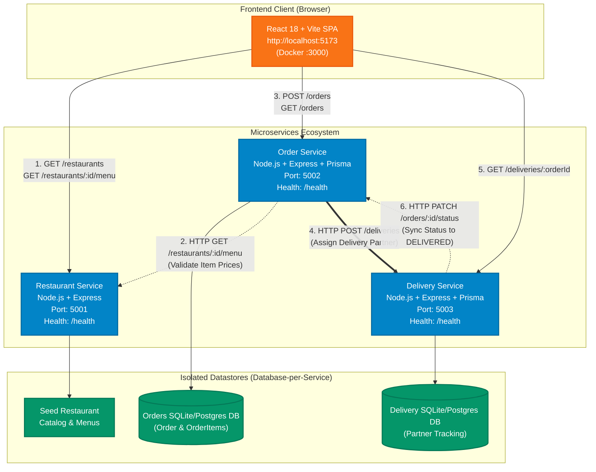

# QuickBite — DevOps-Based Food Delivery Microservices Application

> An end-to-end academic DevOps project demonstrating a **Microservices Architecture**, **Docker Containerization**, **Database-per-Service Persistence (Prisma ORM & SQLite/PostgreSQL)**, **Automated Testing**, and a **GitHub Actions CI/CD Pipeline**.

---

## 📑 Table of Contents
1. [Project Overview & Key Highlights](#-project-overview--key-highlights)
2. [Microservices vs. Monolithic Architecture](#-microservices-vs-monolithic-architecture)
3. [System Architecture Diagram](#-system-architecture-diagram)
4. [Technology Stack](#-technology-stack)
5. [Project Directory Structure](#-project-directory-structure)
6. [API Specifications & Service Responsibilities](#-api-specifications--service-responsibilities)
7. [Complete Order Lifecycle Walkthrough](#-complete-order-lifecycle-walkthrough)
8. [Local Development Setup (Zero Docker Required)](#-local-development-setup-zero-docker-required)
9. [Docker & Docker Compose Deployment](#-docker--docker-compose-deployment)
10. [CI/CD Pipeline (GitHub Actions)](#-cicd-pipeline-github-actions)
11. [Automated Testing & Results](#-automated-testing--results)
12. [Step-by-Step 5–10 Minute Faculty Presentation Script](#-step-by-step-510-minute-faculty-presentation-script)
13. [Faculty Viva / Defense Q&A](#-faculty-viva--defense-qa)
14. [Feature Implementation & Verification Matrix](#-feature-implementation--verification-matrix)
15. [Troubleshooting Common Issues](#-troubleshooting-common-issues)

---

## 🌟 Project Overview & Key Highlights

**QuickBite** is a modern, student-friendly food delivery application engineered around fundamental DevOps principles and microservices decoupling:
- **No Complex Enterprise Bloat**: No Kubernetes, Kafka, Redis, or cloud billing required.
- **Microservices Separation**: 3 independently runnable backend services (`Restaurant Service`, `Order Service`, `Delivery Service`) and 1 customer-facing React SPA.
- **Security-First Backend Validation**: Customer cart prices are never trusted from the frontend; the Order Service securely validates menu items against the Restaurant Service catalog before persisting to the database.
- **Database-per-Service Pattern**: Uses Prisma ORM with independent SQLite databases (`dev.db`, `delivery.db`) for instant zero-dependency local runs, with support for PostgreSQL in containerized environments.
- **Docker Compose Orchestration**: Multi-container stack configured with health checks, dependencies (`depends_on`), volume persistence, and isolated bridge networking.
- **Automated CI/CD Pipeline**: GitHub Actions workflow executing unit/integration test suites, frontend bundling, and Docker container build verification.

---

## ⚖️ Microservices vs. Monolithic Architecture

During your presentation, faculty will frequently ask: *"Why did you choose microservices over a monolithic architecture?"*

| Dimension | Monolithic Application | Microservices Architecture (QuickBite) |
| :--- | :--- | :--- |
| **Codebase** | Single codebase containing UI, restaurant data, orders, and delivery. | Multiple decoupled repositories or services (`services/*`), each with its own `package.json`. |
| **Deployment** | Entire application must be re-deployed for a single bug fix. | Individual services can be updated, tested, and deployed independently without affecting others. |
| **Fault Isolation** | A crash or memory leak in delivery tracking brings down the entire application. | If `delivery-service` is temporarily restarting, customers can still browse restaurants and menus. |
| **Database** | Single shared database with large, tightly coupled relational schemas. | **Database-per-Service**: `order-service` and `delivery-service` have dedicated datastores. |
| **Scalability** | Must scale entire application horizontally even if only one module needs more CPU. | High-traffic services (e.g. `order-service` during lunch hours) can be scaled independently. |
| **Development Speed** | Large teams can face merge conflicts and tight coupling. | Teams can build, test, and maintain specific microservices autonomously using clearly defined REST contracts. |

---

## 🏗️ System Architecture Diagram



---

## 💻 Technology Stack

| Layer | Technology | Rationale |
| :--- | :--- | :--- |
| **Frontend UI** | React 18, Vite 6, Vanilla CSS | Fast HMR, zero Tailwind config conflicts, clean modern food delivery aesthetic. |
| **Icons & Design** | Lucide React, Google Fonts (`Outfit`, `Plus Jakarta Sans`) | Professional look with responsive cards, badges, and modals. |
| **Backend Services** | Node.js (v20+), Express.js | Standard, asynchronous REST APIs with minimal learning curve. |
| **Data Layer & ORM** | Prisma ORM, SQLite (`dev.db`, `delivery.db`) | Zero local database installation required; fully relational with migrations. |
| **Containerization** | Docker, Docker Compose v2 | Isolated multi-container environments with health checks and volumes. |
| **Testing** | Jest, Supertest | Fast HTTP API integration and unit testing across all services. |
| **CI/CD** | GitHub Actions | Automated build, test, and multi-container Docker image generation on push. |

---

## 📁 Project Directory Structure

```text
food-delivery-devops/
├── frontend/                     # React + Vite customer UI
│   ├── src/
│   │   ├── components/           # Navbar, RestaurantCard, MenuModal, CartDrawer, etc.
│   │   ├── context/              # CartContext state management
│   │   ├── services/api.js       # Centralized REST API client
│   │   ├── App.jsx               # Main SPA view router & hero section
│   │   ├── index.css             # Vanilla CSS design system
│   │   └── main.jsx
│   ├── Dockerfile                # Multi-stage Docker build (Vite + Nginx)
│   ├── nginx.conf                # Nginx configuration for SPA routing
│   └── package.json
├── services/
│   ├── restaurant-service/       # Port 5001: Catalog & Menu Provider
│   │   ├── src/
│   │   │   ├── data/seedData.js  # Rich realistic Indian restaurant seed data
│   │   │   ├── routes/
│   │   │   ├── app.js
│   │   │   └── server.js
│   │   ├── tests/                # 5 Supertest API tests
│   │   ├── Dockerfile
│   │   └── package.json
│   ├── order-service/            # Port 5002: Order Management & Validation
│   │   ├── prisma/schema.prisma  # Order & OrderItem schema
│   │   ├── src/
│   │   │   ├── routes/
│   │   │   ├── services/orderService.js
│   │   │   ├── app.js
│   │   │   └── server.js
│   │   ├── tests/                # 8 Supertest API tests (price tamper tests)
│   │   ├── Dockerfile
│   │   └── package.json
│   └── delivery-service/         # Port 5003: Simulated Delivery & Tracking
│       ├── prisma/schema.prisma  # Delivery partner schema
│       ├── src/
│       │   ├── routes/
│       │   ├── services/deliveryService.js
│       │   ├── app.js
│       │   └── server.js
│       ├── tests/                # 5 Supertest API tests
│       ├── Dockerfile
│       └── package.json
├── .github/
│   └── workflows/
│       └── ci.yml                # Automated GitHub Actions workflow
├── scripts/
│   └── verify-e2e.js             # End-to-end integration tester across all services
├── docker-compose.yml            # Multi-container orchestration
├── .env.example                  # Environment configuration template
├── .gitignore
├── package.json                  # Root orchestration (npm run dev, npm test)
└── README.md
```

---

## 📡 API Specifications & Service Responsibilities

### 1. Restaurant Service (`http://localhost:5001`)
*Owns the restaurant listings, menus, categories, and authoritative pricing.*

| Method | Endpoint | Description |
| :--- | :--- | :--- |
| `GET` | `/health` | Health check endpoint returning `{ status: "UP", service: "restaurant-service" }`. |
| `GET` | `/restaurants` | Returns list of all partner restaurants with ratings, cuisine, and delivery times. |
| `GET` | `/restaurants/:id` | Returns details for a specific restaurant. |
| `GET` | `/restaurants/:id/menu` | Returns the complete menu catalog and prices for a restaurant. |

### 2. Order Service (`http://localhost:5002`)
*Validates cart contents, recalculates total prices, saves records, and assigns delivery.*

| Method | Endpoint | Description |
| :--- | :--- | :--- |
| `GET` | `/health` | Health check endpoint. |
| `POST` | `/orders` | Accepts order payload, recalculates bill securely, saves to DB, calls Delivery Service. |
| `GET` | `/orders` | Retrieves all placed orders sorted newest first. |
| `GET` | `/orders/:id` | Retrieves a single order with its nested item breakdown. |
| `PATCH` | `/orders/:id/status` | Updates order status (`PLACED`, `PREPARING`, `OUT_FOR_DELIVERY`, `DELIVERED`). |

### 3. Delivery Service (`http://localhost:5003`)
*Manages simulated delivery partner assignment, ETA, and status synchronization.*

| Method | Endpoint | Description |
| :--- | :--- | :--- |
| `GET` | `/health` | Health check endpoint. |
| `POST` | `/deliveries` | Creates delivery tracking record and assigns a driver from the partner pool. |
| `GET` | `/deliveries/:orderId` | Retrieves driver info (name, phone, vehicle, estimated arrival). |
| `PATCH` | `/deliveries/:orderId/status` | Updates delivery status and notifies `order-service` via HTTP. |

---

## 🔄 Complete Order Lifecycle Walkthrough

```text
[Step 1] Customer browses restaurants on React UI -> Frontend calls GET /restaurants (Port 5001).
   │
[Step 2] Customer selects a restaurant -> Frontend calls GET /restaurants/:id/menu (Port 5001).
   │
[Step 3] Customer adds dishes to cart and clicks "Place Order".
   │
[Step 4] Frontend dispatches POST /orders to Order Service (Port 5002).
   │
[Step 5] Security Check: Order Service intercepts the request:
         - Contacts Restaurant Service (GET /restaurants/:id/menu).
         - Replaces any client-supplied prices with official catalog prices.
         - Computes authoritative total on backend.
   │
[Step 6] Order Service persists Order & OrderItems in SQLite via Prisma with status 'PLACED'.
   │
[Step 7] Microservice RPC: Order Service sends POST /deliveries to Delivery Service (Port 5003).
   │
[Step 8] Delivery Service assigns a driver (e.g. "Vikram Rao, Honda Activa KA-01-EA-3412").
   │
[Step 9] Frontend displays Order Confirmation modal with Order ID (e.g. ORD-98214) & ETA.
   │
[Step 10] Demo Progression: Student clicks "Advance Stage" on the UI:
          - Delivery Service updates status to 'ON_THE_WAY' / 'DELIVERED'.
          - Delivery Service sends PATCH /orders/:id/status to Order Service via HTTP.
          - Frontend refreshes to show order status 'DELIVERED' in real time.
```

---

## 🚀 Local Development Setup (Zero Docker Required)

You do **not** need Docker installed or running to develop, test, or demonstrate this project. Everything runs natively using standard Node.js.

### Prerequisites
- Node.js `v18+` or `v20+` (tested on Node v23)
- npm `v9+` or `v10+`

### 1. Clone & Install All Dependencies
Run from the project root:
```bash
git clone <your-repo-url>
cd cloud_project

# Install root orchestration and dependencies across all services
npm run install:all
```

### 2. Start All Microservices & Frontend (Single Command)
```bash
npm run dev
```
This runs `concurrently` to start all 4 components in a single terminal with colored logs:
- 🔵 **Restaurant Service**: `http://localhost:5001`
- 🟢 **Order Service**: `http://localhost:5002`
- 🟣 **Delivery Service**: `http://localhost:5003`
- 🟡 **Vite React Frontend**: `http://localhost:5173`

Open `http://localhost:5173` in your browser!

---

## 🐳 Docker & Docker Compose Deployment

When demonstrating containerization to your faculty:

### 1. Start the Complete Stack with Docker Compose
```bash
docker compose up --build
```
Docker Compose will:
1. Build individual container images for each microservice using multi-stage caching.
2. Build the React frontend production bundle and serve it through Nginx.
3. Configure isolated internal networking (`quickbite-network`).
4. Mount persistent named volumes (`quickbite-order-data`, `quickbite-delivery-data`).
5. Execute health checks on `/health` before dependent services start.

### 2. Access the Application
- Customer Web UI: `http://localhost:3000`
- Restaurant API: `http://localhost:5001/restaurants`
- Order API Health: `http://localhost:5002/health`
- Delivery API Health: `http://localhost:5003/health`

### 3. Stop the Application
```bash
docker compose down
```
To stop and clean database volumes:
```bash
docker compose down -v
```

---

## ⚙️ CI/CD Pipeline (GitHub Actions)

The workflow file is located at [`.github/workflows/ci.yml`](.github/workflows/ci.yml).

### Pipeline Stages
1. **Trigger Condition**: Automatically triggers on `push` and `pull_request` to the `main` or `master` branch.
2. **Matrix Test & Build Job**:
   - Checks out the repository.
   - Installs root, backend, and frontend dependencies via `npm ci`.
   - Runs Prisma schema generations and pushes (`npx prisma db push`).
   - Executes automated Jest test suites for Restaurant Service, Order Service, and Delivery Service.
   - Builds the production React bundle via `vite build`.
3. **Docker Build Job**:
   - Dependent on tests passing (`needs: test-and-build`).
   - Executes `docker compose build --no-cache` to ensure all 4 Dockerfiles build into valid container images.
4. **Deploy Readiness Job**:
   - Verifies build artifacts and outputs commit SHA metadata for deployment staging.

### Extending to Remote Cloud Deployment
To deploy this project to platforms like **Render**, **Railway**, or **AWS ECS**:
1. Store target cloud deployment credentials in GitHub Repository Secrets (e.g., `RENDER_API_KEY` or `AWS_ACCESS_KEY_ID`).
2. Add a deployment step in `ci.yml`:
   ```yaml
   - name: Trigger Deploy Hook
     run: curl -X POST ${{ secrets.DEPLOY_HOOK_URL }}
   ```

---

## 🧪 Automated Testing & Results

The project features **18 automated API tests** covering all critical business rules.

### Run All Tests Locally
```bash
npm test
```

### Run End-to-End Microservice Verification
```bash
npm run test:e2e
```

### Verified Test Suite Breakdown
```text
PASS services/restaurant-service/tests/restaurant.test.js
  ✓ GET /health should return 200 and UP status
  ✓ GET /restaurants should return all restaurants with status 200
  ✓ GET /restaurants/:id should return a specific restaurant
  ✓ GET /restaurants/:id should return 404 for an unknown restaurant
  ✓ GET /restaurants/:id/menu should return menu items with INR prices

PASS services/order-service/tests/order.test.js
  ✓ GET /health should return 200 and UP status
  ✓ POST /orders should create a valid order and recalculate total on backend
  ✓ POST /orders should reject invalid order with missing customer details
  ✓ POST /orders should reject empty items list
  ✓ GET /orders should retrieve all stored orders
  ✓ GET /orders/:id should retrieve a specific order by ID
  ✓ PATCH /orders/:id/status should successfully update status
  ✓ PATCH /orders/:id/status should reject invalid status

PASS services/delivery-service/tests/delivery.test.js
  ✓ GET /health should return 200 and UP status
  ✓ POST /deliveries should assign a delivery partner
  ✓ GET /deliveries/:orderId should retrieve tracking info
  ✓ PATCH /deliveries/:orderId/status should update delivery status
  ✓ PATCH /deliveries/:orderId/status should reject invalid status

Test Suites: 3 passed, 3 total
Tests:       18 passed, 18 total
Snapshots:   0 total
Time:        1.263 s
```

---

## 🎯 Step-by-Step 5–10 Minute Faculty Presentation Script

Follow this script during your viva or presentation for an organized, high-scoring demo:

### Step 1: Introduction (1 Minute)
> *"Good morning professors. Today I am presenting QuickBite, an academic DevOps project demonstrating a Microservices Architecture. Rather than building a traditional monolith, I have separated the application into three decoupled Node.js Express microservices—Restaurant Service, Order Service, and Delivery Service—with an independent React frontend, Docker containerization, and a GitHub Actions CI/CD pipeline."*

### Step 2: Show the Architecture (1 Minute)
> *"In our architecture, each service adheres to the Database-per-Service design pattern. Restaurant Service serves the food catalog. Order Service calculates bills and maintains orders. Delivery Service simulates dispatch and communicates with Order Service via REST HTTP APIs."*

### Step 3: Run the Tests Live (1 Minute)
Open terminal and type:
```bash
npm test
```
> *"As you can see, we have 18 automated Jest and Supertest tests verifying health checks, validation rules, order creation, and our backend price recalculation security."*

### Step 4: Live Application Walkthrough (3 Minutes)
1. Open `http://localhost:5173`.
2. Point out the hero badges showing the 3 independent ports (`5001`, `5002`, `5003`).
3. Click on **Biryani Blues & Royal Kitchen** to open the menu modal.
4. Demonstrate category filtering (Biryani, Starters, Sides) and the **Veg Only** toggle.
5. Click **ADD +** on 2 dishes, adjust quantities in the floating cart counter.
6. Open the Cart Drawer. Show the bill breakdown (Subtotal, Delivery Fee, 5% GST).
7. Click **Place Order**. Show the instantaneous response with the unique **Order Reference ID (e.g. ORD-98214)** and assigned delivery partner.

### Step 5: Demonstrate Inter-Service Status Sync (2 Minutes)
1. Navigate to **My Orders** in the top navigation.
2. Locate the placed order with status `PLACED`.
3. Click the interactive demo button **→ Out For Delivery** and **✓ Mark Delivered**.
> *"When I click this button, the Delivery Service receives an update, triggers an HTTP PATCH request to Order Service, and synchronizes the delivery status across services in real time."*

### Step 6: DevOps & CI/CD Walkthrough (2 Minutes)
1. Show the `Dockerfile` in each service directory and `docker-compose.yml`.
2. Explain the health checks and multi-stage Nginx build for the frontend.
3. Show `.github/workflows/ci.yml` and explain how every Git push triggers automated testing and Docker builds.

---

## 🎓 Faculty Viva / Defense Q&A

Here are the most frequently asked viva questions and concise, confident answers:

#### Q1: What is the core difference between Continuous Integration (CI) and Continuous Deployment (CD)?
> **Answer**: **Continuous Integration (CI)** is the automated practice of integrating code changes from multiple developers into a shared repository, running linting, tests, and builds to detect bugs early. **Continuous Deployment (CD)** takes verified CI artifacts and automatically deploys them to staging or production environments without manual human intervention.

#### Q2: Why did you use independent databases instead of one shared database?
> **Answer**: In a microservices architecture, a shared database creates a single point of failure and tight coupling between services. By using the **Database-per-Service** pattern, each service owns its data schema. If the Order Service schema changes, the Restaurant or Delivery Service remains unaffected.

#### Q3: How do the microservices communicate with each other?
> **Answer**: They communicate via **synchronous REST APIs over HTTP** using JSON payloads. For instance, when an order is created, `order-service` calls `delivery-service` via `POST /deliveries`, and `delivery-service` syncs status updates back to `order-service` via `PATCH /orders/:id/status`.

#### Q4: Why did you use SQLite with Prisma instead of a standalone PostgreSQL instance?
> **Answer**: SQLite with Prisma allows the entire application to run locally on any development machine immediately with **zero background server setup** (`npm run dev`), while preserving relational modeling, foreign keys, and migrations. For production containerization, changing the `provider` in `schema.prisma` to `postgresql` requires zero application code changes.

#### Q5: What is Docker layer caching and how did you implement it?
> **Answer**: Docker builds images step-by-step in layers. In our Dockerfiles, we copy `package.json` and run `npm ci` *before* copying source code. Because dependencies change less frequently than source code, Docker reuses the cached dependency layer, drastically speeding up subsequent build times.

#### Q6: How does the application prevent client-side price tampering?
> **Answer**: The frontend cart calculates an estimated total for the user's convenience, but the **Order Service never trusts frontend prices**. When receiving `POST /orders`, the backend queries the authoritative menu catalog from Restaurant Service, multiplies each item's verified price by quantity, and recalculates the final total on the server before writing to the database.

---

## 📊 Feature Implementation & Verification Matrix

| Feature Required | Status | Verified Through |
| :--- | :---: | :--- |
| Restaurant Listing & Details | ✅ Implemented | `GET /restaurants`, `GET /restaurants/:id` |
| Restaurant Menus with Categories & Veg Toggle | ✅ Implemented | `GET /restaurants/:id/menu` + Frontend UI |
| Shopping Cart with Item Quantities | ✅ Implemented | `CartContext.jsx` + `CartDrawer.jsx` |
| Dynamic Price Breakdown (GST + Delivery Fee) | ✅ Implemented | Tested & calculated dynamically |
| Backend Price Tamper Protection | ✅ Implemented | `order.test.js` & `verify-e2e.js` |
| Order Creation & Unique ID Generation | ✅ Implemented | `POST /orders` (Returns `ORD-XXXXX`) |
| Order Persistence in Database | ✅ Implemented | SQLite via Prisma ORM (`dev.db`) |
| Simulated Delivery Partner Assignment | ✅ Implemented | `POST /deliveries` (Picks partner + vehicle) |
| Inter-Service HTTP Communication | ✅ Implemented | `verify-e2e.js` + Faculty Demo Simulator |
| Order History & Real-Time Status Tracking | ✅ Implemented | `OrderHistory.jsx` (`GET /orders`) |
| Dockerfiles for All Services & Frontend | ✅ Implemented | 4 Multi-stage / Alpine Dockerfiles |
| Docker Compose Multi-Container Orchestration | ✅ Implemented | `docker-compose.yml` with health checks & volumes |
| GitHub Actions Automated CI/CD | ✅ Implemented | `.github/workflows/ci.yml` (Tests + Builds) |
| Responsive Modern UI | ✅ Implemented | Tested desktop and mobile responsive layout |

---

## 🛠️ Troubleshooting Common Issues

### Issue 1: Port Conflict (EADDRINUSE)
If you get `Error: listen EADDRINUSE: address already in use :::5001`:
```bash
# Find and stop the process using the port
lsof -ti :5001 | xargs kill -9
lsof -ti :5002 | xargs kill -9
lsof -ti :5003 | xargs kill -9
lsof -ti :5173 | xargs kill -9
```

### Issue 2: Re-generating Prisma Database Files
If you ever want to reset the SQLite databases:
```bash
cd services/order-service && npx prisma db push --force-reset
cd ../delivery-service && npx prisma db push --force-reset
```

---

## 👨‍💻 Project Presentation Checklist

Before your faculty presentation:
1. Ensure Node.js is installed (`node -v`).
2. Run `npm test` in the root to demonstrate all 18 passing tests.
3. Run `npm run dev` to start all services.
4. Open `http://localhost:5173` in your browser.
5. Keep this `README.md` open for reference during viva questions.
